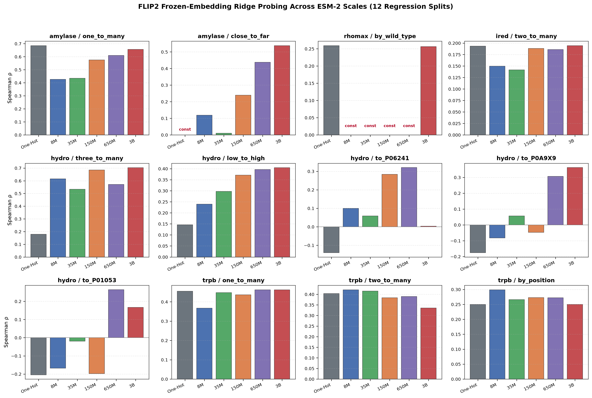
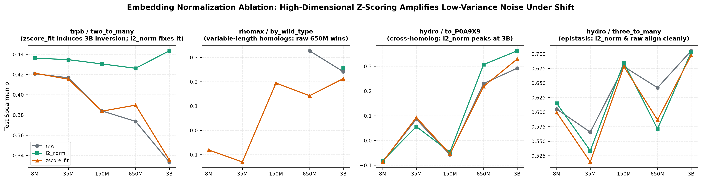
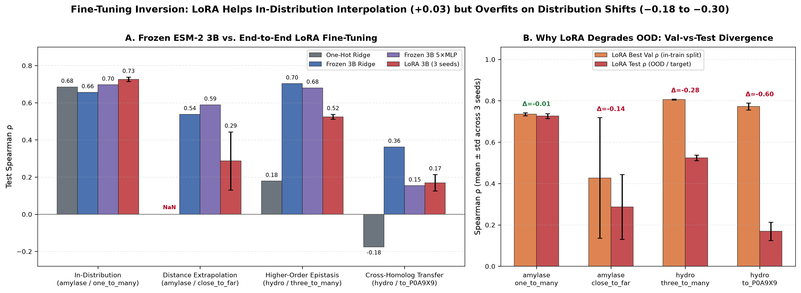
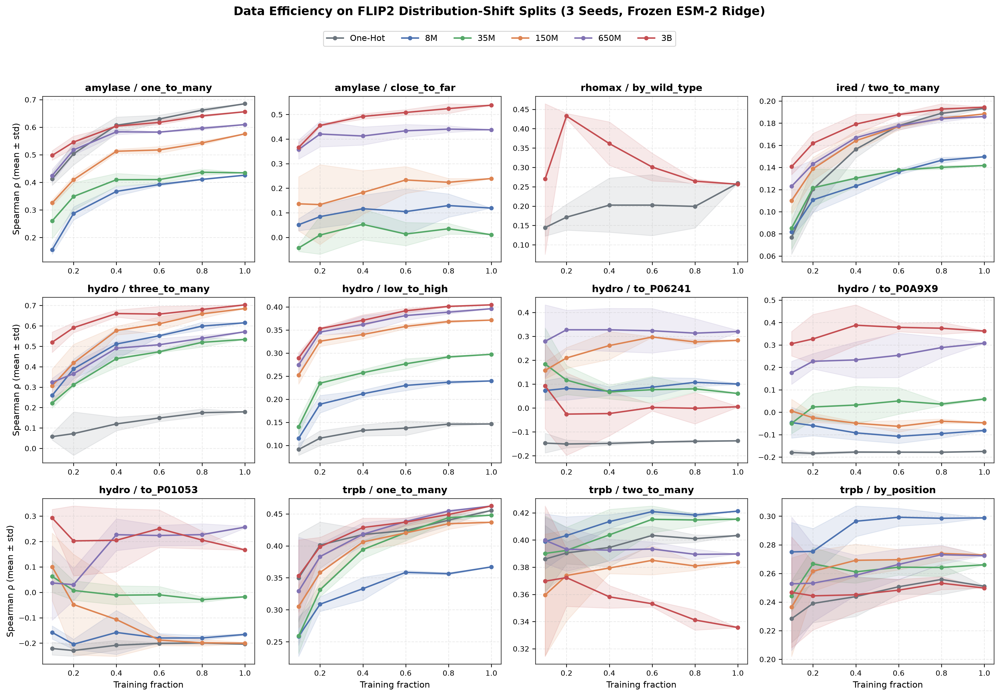
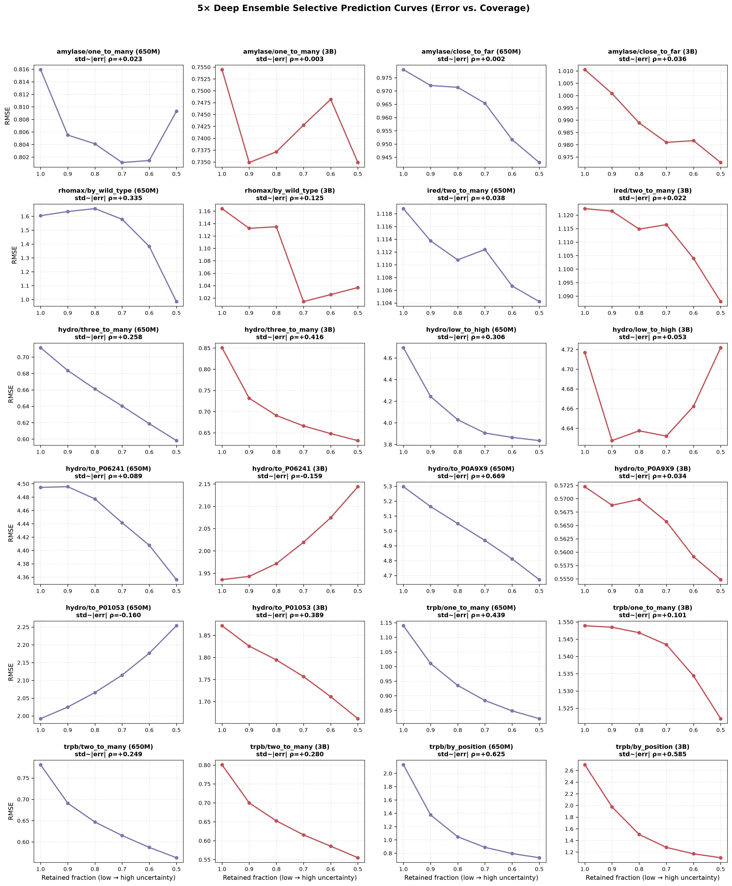
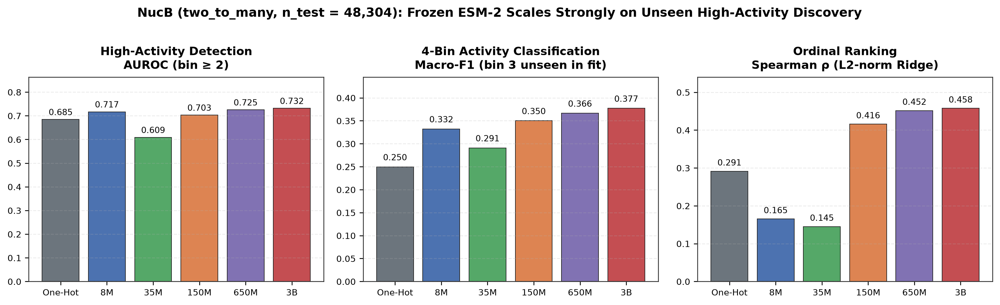
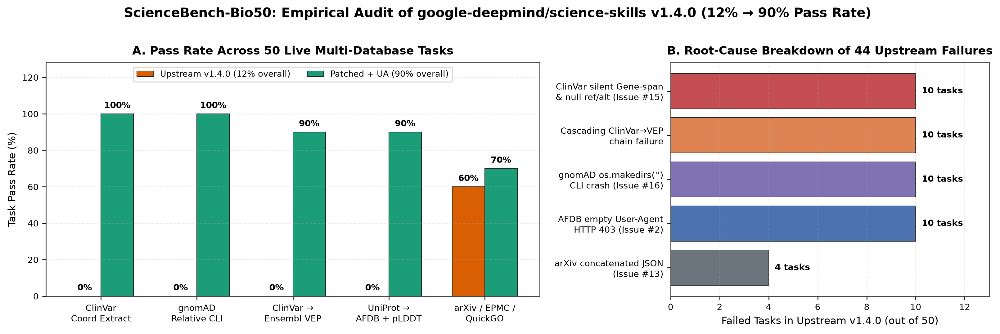

# Protein Language Models Under Real Distribution Shifts (`FLIP2`) & Scientific Agent Tool Reliability (`ScienceBench-Bio50`)

[](https://doi.org/10.5281/zenodo.24496508)
[English](README.md) | [简体中文](README_zh.md) | **[📄 Formal Academic PDF (`FLIP2_Technical_Report.pdf`)](FLIP2_Technical_Report.pdf)** | [`TECHNICAL_REPORT.md`](TECHNICAL_REPORT.md) | **[🧪 Companion Molecule Track (`tdc-admet-ood-conformal-benchmark`)](https://github.com/Der134/tdc-admet-ood-conformal-benchmark)**

This repository contains two reproducible, complementary open-science benchmarks built to guide practical **AI-for-Science protein engineering & variant interpretation workflows**:

1. **Part I — FLIP2 Frozen ESM-2 Probing, Data Efficiency, UQ & 3B LoRA Benchmark (`notebook_01`–`notebook_04`):**
   Evaluates **ESM-2 across all 5 scales (`8M → 3B`)** on **6 datasets and 13 official distribution-shift splits** (**317,976 unique protein sequences**, zero subsampling), comparing sparse one-hot baselines, frozen linear/MLP probing, normalization strategies, 5× Deep Ensemble uncertainty quantification, and end-to-end 3B LoRA fine-tuning.
2. **Part II — `ScienceBench-Bio50`: Empirical Reliability Audit of `google-deepmind/science-skills` (`direction_f_science_skills/`):**
   Audits all 40 skills / 66 Python scripts in `google-deepmind/science-skills` v1.4.0 across 50 live cross-database bioinformatics queries (`ClinVar`, `gnomAD`, `Ensembl VEP`, `UniProt`, `AlphaFold DB`, `arXiv`, `EuropePMC`, `QuickGO`), uncovering two high-severity upstream bugs filed as **[Issue #15](https://github.com/google-deepmind/science-skills/issues/15)** and **[Issue #16](https://github.com/google-deepmind/science-skills/issues/16)**.

---

## Part I — Key Findings in Plain Language (FLIP2 Benchmark)

> **TL;DR for practitioners:** If you are predicting protein fitness **out-of-distribution** (distant combinatorial mutants, higher-order epistasis, or unseen homologs), **do NOT blindly fine-tune ESM-2 3B with LoRA or apply naive per-feature z-scoring**. Start with an **L2-normalized frozen ESM-2 650M/3B linear probe** plus a **5× MLP ensemble** for uncertainty filtering.

### 1. Frozen PLMs Shine Under Extrapolation — While One-Hot Holds Its Own Locally
When testing on mutants far from the training neighborhood (`amylase/close_to_far`), higher-order epistasis (`hydro/three_to_many`), or completely different homologous proteins (`hydro/to_P06241`, `to_P0A9X9`, `to_P01053`), one-hot sequence encodings collapse (`NaN`) or turn **negatively correlated** ($\rho \in [-0.20, -0.14]$). Frozen ESM-2 650M/3B embeddings unlock strong generalization ($\rho = 0.54\text{–}0.70$ within-family; $+0.26\text{–}+0.36$ across unaligned homologs).



### 2. Why Per-Feature Z-Scoring Can Invert Scaling Laws (and How L2-Norm Fixes It)
On `trpb/two_to_many` ($n_{\text{fit}}=8{,}633$ shallow mutants tested on $217{,}507$ higher-order variants), standard feature-wise z-scoring (`zscore_fit`) causes a counterintuitive **inverse scaling trend** where 3B (`0.336`) underperforms 8M (`0.421`). Why? Dividing 2,560-dimensional embeddings by tiny training standard deviations amplifies OOD noise. Simply switching to **row-wise L2 normalization (`l2_norm`)** restores ESM-2 3B to **#1 overall (`0.443`)** and cuts MSE from `1.310 → 0.888`.



### 3. Fine-Tuning Inversion: 3B LoRA Helps Locally (+0.03) but Degrades Every OOD Split (−0.18 to −0.30)
Under FLIP2's realistic protocol, the validation set is drawn from the *training* distribution. End-to-end LoRA fine-tuning on ESM-2 3B (3 random seeds) improves **in-distribution** prediction (`amylase/one_to_many`: `0.697 → 0.726 ± 0.012`), **but hurts every tested distribution-shift split** (`close_to_far`: `0.589 → 0.287`; `three_to_many`: `0.703 → 0.524`; `to_P0A9X9`: `0.362 → 0.169`). Because validation scores climb to `0.61–0.81` during LoRA training, `val_mse` early stopping cannot see that the pretrained evolutionary geometry is drifting away from the target domain.



| Dataset / Split | Shift Regime | One-Hot $\rho$ | Frozen 3B Ridge | Frozen 3B 5×MLP | **LoRA 3B (3 seeds)** | Best Approach |
|---|---|---:|---:|---:|---|---|
| `amylase / one_to_many` | In-distribution | 0.685 | 0.656 | 0.697 | **0.726 ± 0.012** | **LoRA 3B** (+0.029) |
| `amylase / close_to_far` | Distance extrap. | `const` | 0.538 | **0.589** | 0.287 ± 0.156 | **Frozen 3B 5×MLP** |
| `hydro / three_to_many` | Epistasis extrap. | 0.179 | **0.703** | 0.680 | 0.524 ± 0.013 | **Frozen 3B Ridge** |
| `hydro / to_P0A9X9` | Cross-homolog | -0.176 | **0.362** | 0.154 | 0.169 ± 0.044 | **Frozen 3B Ridge** |

### 4. Data Efficiency, NucB High-Activity Discovery & Deep Ensemble Uncertainty
- **10× Label Savings (`fig2`):** On `amylase/close_to_far`, frozen `esm2_3b` with **10% labels** ($\rho=0.366$) outperforms `esm2_150m` with **100% labels** ($0.239$).
- **Unseen Optimal Bin (`nucb`, `fig4`):** Even when the highest activity class (`bin=3`) never appears in `fit`, frozen `esm2_3b` lifts 4-bin Macro-F1 by **+51%** (`0.250 → 0.377`) and high-activity (`bin ≥ 2`) AUROC to `0.732`.
- **Selective Prediction & Its Blind Spot (`fig3`):** Filtering out the 50% highest-variance predictions from a 5× MLP ensemble cuts RMSE by **−59.1% to −65.6%** on `trpb/by_position` (`std~|err| ρ ≈ 0.60`), while exposing a clear epistemic blind spot when an unseen homolog shifts globally in mean activity (`hydro/to_P06241`).

<details>
<summary><b>Click to view Figures 2, 3, and 4 (Data Efficiency, 5× Ensemble UQ, and NucB Classification)</b></summary>





</details>

---

## Part II — `ScienceBench-Bio50`: Auditing `google-deepmind/science-skills`

While preparing our next-phase **ClinVar VUS + AlphaGenome** benchmark, we systematically audited all 40 skills (66 Python wrapper scripts) in [`google-deepmind/science-skills`](https://github.com/google-deepmind/science-skills) v1.4.0 across **50 live multi-database tasks**.

- **Upstream v1.4.0 pass rate:** **6 / 50 (12.0%)**
- **After 3 minimal script patches + `POLITE_HTTP_USER_AGENT`:** **45 / 50 (90.0%)**



| Discovered Issue | Scope & Impact | Upstream Status |
|---|---|---|
| **Silent Gene-Span & Null Ref/Alt Corruption in `clinvar_api.py`** | `_extract_allele_info()` breaks on `<Gene>/<SequenceLocation>` instead of `<SimpleAllele>/<Location>/<SequenceLocation>`, returning 50–126 kb gene spans with `ref=null, alt=null` on **10/10** variants and breaking **10/10** downstream Ensembl VEP chains. | Filed: **[Issue #15](https://github.com/google-deepmind/science-skills/issues/15)** (verified patch included) |
| **`os.makedirs('')` Crash on Relative `--output` Paths** | Every example in `gnomad_database/SKILL.md` uses a relative filename (`--output variant_frequency.json`), causing **10/10** crashes (`FileNotFoundError: ''`). Also affects `alphagenome_single_variant_analysis`. | Filed: **[Issue #16](https://github.com/google-deepmind/science-skills/issues/16)** (verified patch included) |
| **arXiv Multi-Result Invalid JSON** | `search_arxiv.py` prints inside the `for entry` loop when `results > 1` (4/5 failures). | Open upstream **[Issue #13](https://github.com/google-deepmind/science-skills/issues/13)** |
| **AlphaFold DB Empty User-Agent 403** | Default empty UA triggers HTTP 403 (`10/10` first-call failures); recovers cleanly when `POLITE_HTTP_USER_AGENT` is set. | Intentional per **[Issue #2](https://github.com/google-deepmind/science-skills/issues/2)** |

---

## Repository Structure & Reproducibility

| Component | Path | Notes |
|---|---|---|
| Technical Report (Full Paper) | [`TECHNICAL_REPORT.md`](TECHNICAL_REPORT.md) | Complete 6-dataset, 13-split protocol, tables & analysis |
| Direction F Audit Report | [`direction_f_science_skills/DIRECTION_F_AUDIT_REPORT.md`](direction_f_science_skills/DIRECTION_F_AUDIT_REPORT.md) | 50-task audit methodology, diffs & issue links |
| Colab Notebooks (`01`–`04`) | `notebook_01_*.ipynb` … `notebook_04_*.ipynb` | Generated by `build_nb01.py`–`build_nb04.py` + `lora_core.py` |
| Verified Metric Tables | [`results/tables/`](results/tables/) | All 9 CSVs (full 318k embeddings + 3B LoRA) |
| Direction F Harness & Patches | [`direction_f_science_skills/`](direction_f_science_skills/) | `patch_builder.py`, `run_science_bench_50.py`, `patches/*.patch` |
| Publication Figures (`fig1`–`fig7`) | [`paper_figures/`](paper_figures/) | Regenerate locally with `python generate_paper_figures.py` |

### Quick Local Verification (0 GPU Cost)

```bash
pip install -r requirements.txt
python verify_nb02_logic.py
python verify_nb04_logic.py
python generate_paper_figures.py
```

---

## Citations & Attribution

If you build upon this benchmark or code, please cite the underlying datasets and models:
- **FLIP2:** Didi et al. (2026), *ICML 2026* — `https://doi.org/10.64898/2026.02.23.707496`
- **FLIP:** Dallago et al. (2021), *NeurIPS Datasets & Benchmarks*
- **ESM-2:** Lin et al. (2023), *Science*, 379(6637)
- **Science Skills:** Google DeepMind (`https://github.com/google-deepmind/science-skills`, Apache 2.0)
