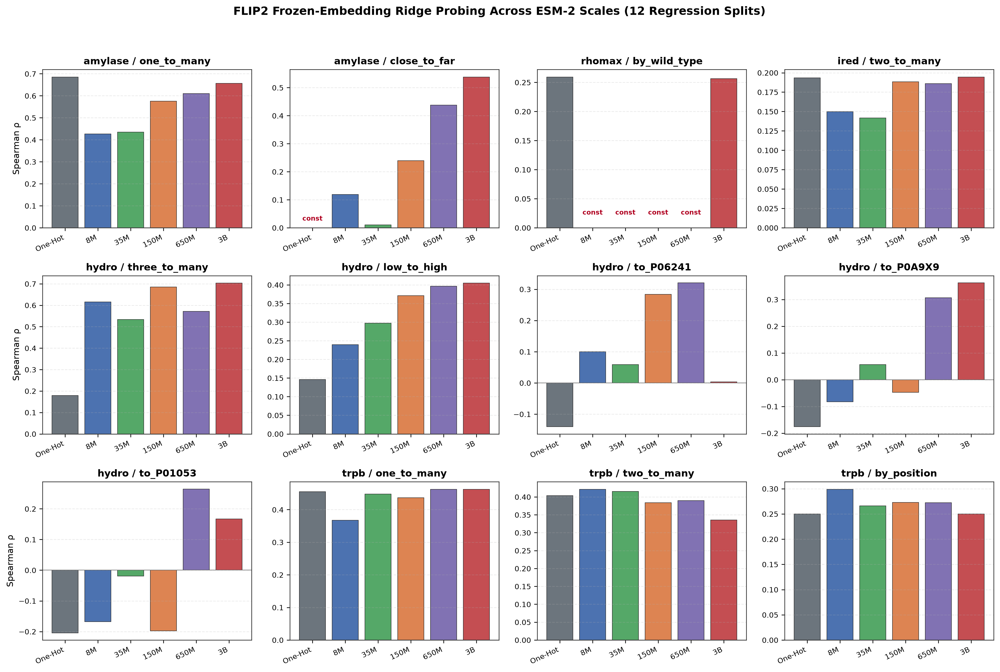
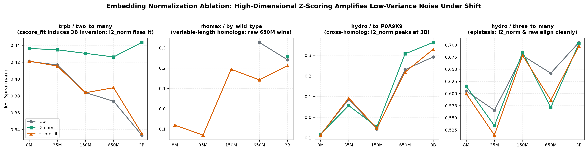
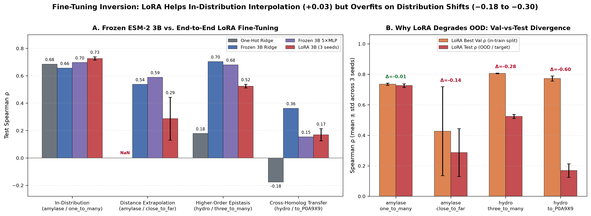
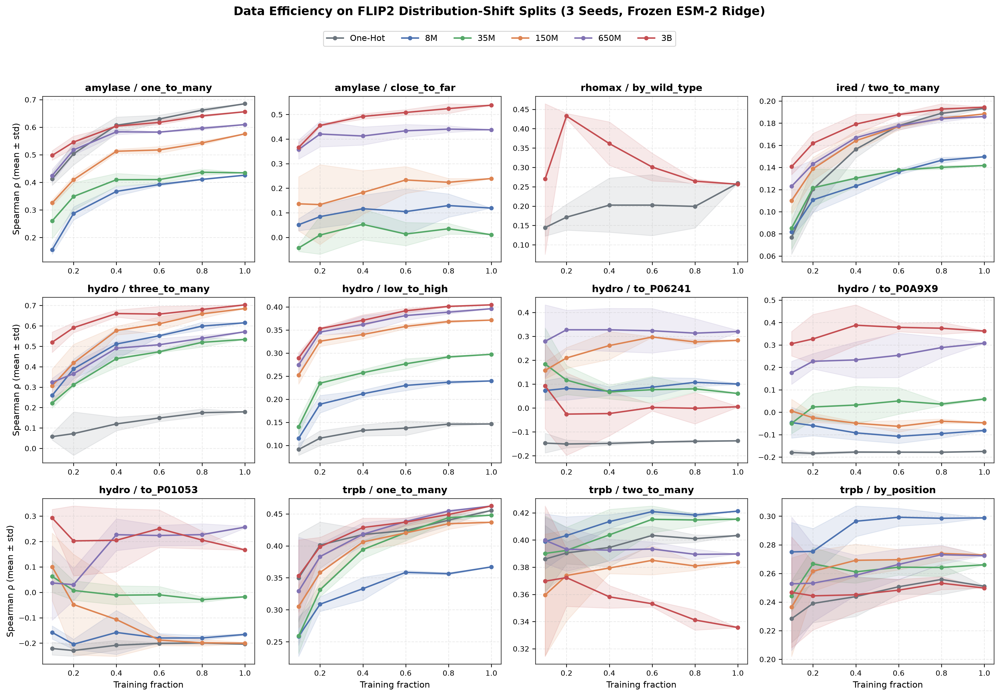
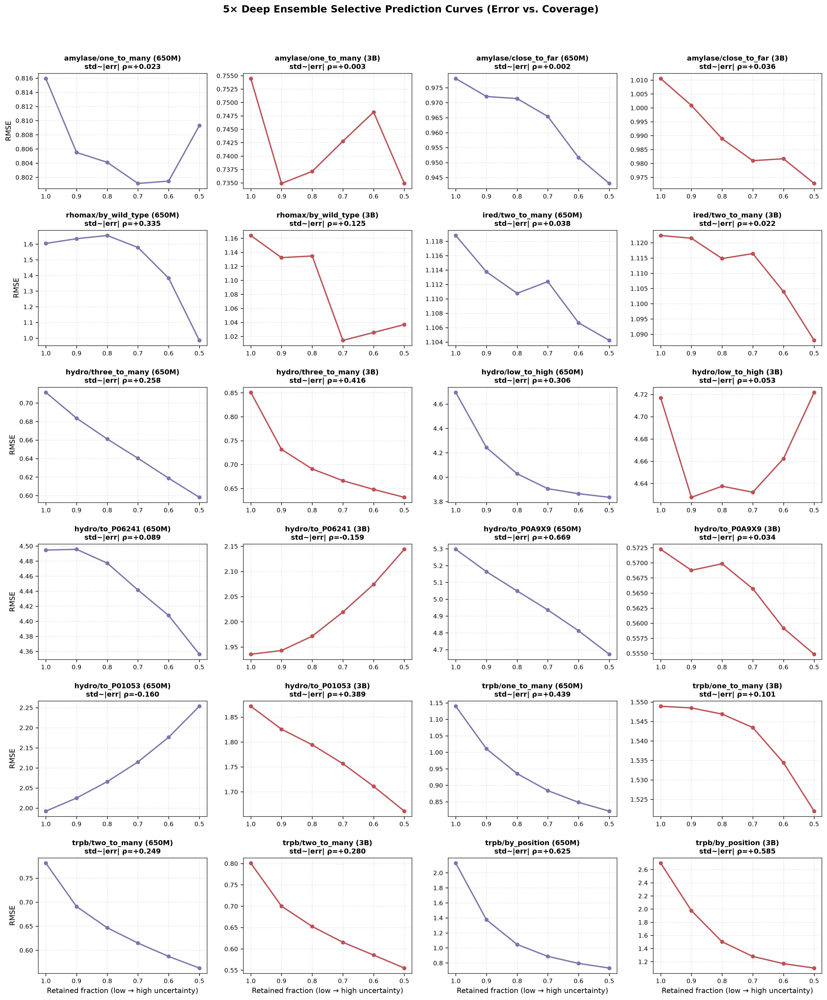
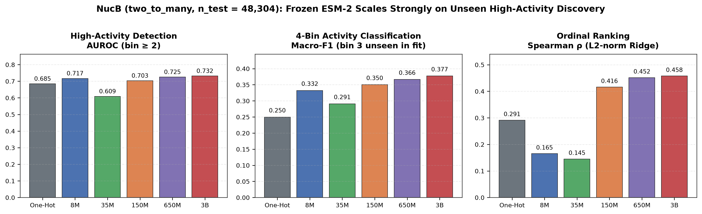
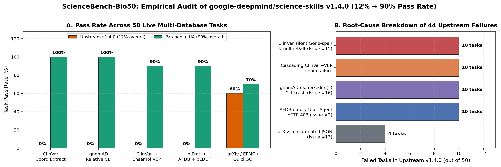

# 蛋白质语言模型在真实分布偏移下的缩放规律评测（FLIP2）与科研 Agent 工具链可靠性审计（ScienceBench-Bio50）

[English](README.md) | [简体中文](README_zh.md) | **[📄 正式学术双栏 PDF 报告 (`FLIP2_Technical_Report.pdf`)](FLIP2_Technical_Report.pdf)** | [`TECHNICAL_REPORT.md`](TECHNICAL_REPORT.md)

本仓库包含两个相互衔接、全部可一键复现的 **AI for Science 开源基准项目**：

1. **第一部分 — FLIP2 冻结表征探针、数据效率、不确定性量化与 3B LoRA 对比基准（`notebook_01`–`notebook_04`）**：
   严格遵循 FLIP2 官方协议，在 **6 个数据集、13 个分布偏移切分**（总计 **317,976 条唯一蛋白序列**，包含 228k 全量 TrpB，零子采样）上系统评测 **ESM-2 全尺度梯度（8M → 3B）**、One-Hot 基线、特征归一化消融、5× 深集成不确定性（UQ）以及 3B LoRA 端到端微调。
2. **第二部分 — `ScienceBench-Bio50`：`google-deepmind/science-skills` 实测可靠性评测（`direction_f_science_skills/`）**：
   审计了 `google-deepmind/science-skills` v1.4.0 全部 40 个技能 / 66 个 Python 脚本，并在 50 个真实跨库生信查询任务（`ClinVar`、`gnomAD`、`Ensembl VEP`、`UniProt`、`AlphaFold DB`、`arXiv`、`EuropePMC`、`QuickGO`）上做修复前后对比，向官方仓库提交了 2 个带最小复现与补丁的高危 Bug Issue：**[Issue #15](https://github.com/google-deepmind/science-skills/issues/15)** 与 **[Issue #16](https://github.com/google-deepmind/science-skills/issues/16)**。

---

## 第一部分：FLIP2 核心发现（通俗版解读）

> **一句话给蛋白工程从业者：** 当你的预测任务需要**外推到未见过的高阶突变组合或不同同源蛋白**时，**不要盲目对 3B 大模型做 LoRA 微调，也不要直接对高维嵌入做逐维 Z-score 标准化**。最稳、性价比最高的首选方案是：**L2 归一化的冻结 ESM-2 650M/3B 线性探针 + 5× MLP 深集成不确定性筛选**。

### 1. 越需要“外推”，大模型冻结表征越不可替代；局部单点扫描 One-Hot 依然能打
- 在**远距离组合外推**（`amylase/close_to_far`）、**高阶上位性外推**（`hydro/three_to_many`）和**跨同源蛋白迁移**（`hydro/to_P06241`, `to_P0A9X9`, `to_P01053`）上，传统 One-Hot 编码要么完全失效塌缩为常数（`NaN`），要么出现**负相关**（$\rho = -0.14 \sim -0.20$）；而冻结 ESM-2 650M/3B 能随参数量提升到 $\rho = 0.54\text{–}0.70$（跨蛋白也稳定正相关 $+0.26\text{–}+0.36$）。
- 反之，在单野生型局部微扰扫描（`amylase/one_to_many`）上，One-Hot 线性探针（`0.685`）依然接近冻结 3B 线性探针（`0.656`）。



### 2. 方法论陷阱：为什么高维 `zscore_fit` 会让 3B 越训越差？（L2 归一化一键修复）
在 `trpb/two_to_many`（用 8,633 条 1–2 点突变预测 217,507 条高阶突变体）上，如果按常规对 2,560 维的 3B 嵌入做逐维标准差归一化（`zscore_fit`），会出现反直觉的**“逆缩放”**（`8M 0.421 > 35M 0.415 > 150M 0.384 > 3B 0.336`）。原因在于浅层训练集里有大量维度方差极小，除以极小标准差会在分布外测试集上把微扰放大成噪声；只要改用**行向 L2 归一化（`l2_norm`）**，ESM-2 3B 立刻反转跃居**全场第一（`0.443`）**，MSE 从 `1.310` 降到 `0.888`。



### 3. 微调反转（Fine-Tuning Inversion）：3B LoRA 局部更强（+0.03），但分布外全线退化（−0.18 至 −0.30）
我们在 4 个代表性切分上对比了 `ESM-2 3B LoRA`（3 种子）与冻结 3B 探针，发现了一个极其清晰的反转现象：
- **同分布局部插值（`amylase/one_to_many`）**：LoRA 把 $\rho$ 从冻结 `0.697` 进一步推高到 **`0.726 ± 0.012`**。
- **分布外切分（`close_to_far` / `three_to_many` / `to_P0A9X9`）**：因为 FLIP2 的 `validation` 集是从 `train` 域内抽取的，LoRA 在训练过程中把验证集指标刷得极高（`val ρ = 0.61~0.81`），却严重过拟合训练域、破坏了预训练表征的进化几何——导致测试集 Spearman 反而比冻结 3B 暴跌 **−0.18 到 −0.30**！



| 数据集 / 切分 | 偏移类型 | One-Hot $\rho$ | 冻结 3B Ridge | 冻结 3B 5×MLP | **LoRA 3B (3 种子)** | 胜出方案 |
|---|---|---:|---:|---:|---|---|
| `amylase / one_to_many` | 同分布插值 | 0.685 | 0.656 | 0.697 | **0.726 ± 0.012** | **LoRA 3B**（+0.029） |
| `amylase / close_to_far` | 远距离组合外推 | `常数` | 0.538 | **0.589** | 0.287 ± 0.156 | **冻结 3B 5×MLP** |
| `hydro / three_to_many` | 高阶上位性外推 | 0.179 | **0.703** | 0.680 | 0.524 ± 0.013 | **冻结 3B Ridge** |
| `hydro / to_P0A9X9` | 跨蛋白同源迁移 | -0.176 | **0.362** | 0.154 | 0.169 ± 0.044 | **冻结 3B Ridge** |

### 4. 数据效率、NucB 未见最高活性档发现与 5× 深集成不确定性（UQ）
- **10 倍省标注效应（图 2）**：在 `amylase/close_to_far` 上，`esm2_3b` 仅用 **10% 标注（$\rho=0.366$）** 就明显超过 `esm2_150m` 用 **100% 标注（$0.239$）**。
- **高活性发现外推（图 4，NucB）**：即使最高活性档 `bin=3` 在 `fit` 集中**完全未出现**，冻结 `esm2_3b` 仍将 4 分类 Macro-F1 相对 One-Hot 提升 **+51%**（`0.250 → 0.377`），高活性（`bin ≥ 2`）AUROC 达 `0.732`。
- **选择性预测与盲区（图 3）**：用 5× MLP 集成方差丢弃最不确定的 50% 预测后，`trpb/by_position` 测试 RMSE 暴降 **−59.1% ~ −65.6%**（`std~|err| ρ ≈ 0.60`）；同时在 `hydro/to_P06241` 等跨骨架整体偏移场景下，暴露出集成方差无法捕获全局均值偏移的认知盲区。

<details>
<summary><b>点击展开查看图 2（数据效率）、图 3（5× 深集成 UQ 曲线）与图 4（NucB 分类与高活性检测）</b></summary>





</details>

---

## 第二部分：`ScienceBench-Bio50` — 科研 Agent 工具链可靠性实测审计

在推进第二期 **ClinVar 临床变异（VUS）+ AlphaGenome** 基准前，我们对 [`google-deepmind/science-skills`](https://github.com/google-deepmind/science-skills) v1.4.0 的全部 40 个技能（66 个 Python 脚本）进行了静态审计，并搭建了包含 **50 个真实跨库生信任务** 的自动评测集。

- **上游 v1.4.0 直接运行通过率**：**6 / 50（12.0%）**
- **应用 3 处最小修复补丁 + 设置 `POLITE_HTTP_USER_AGENT` 后**：**45 / 50（90.0%）**（+78 个百分点，所有脚本崩溃与静默数据损坏归零）



| 发现的问题 | 影响范围与实测表现 | 官方反馈状态 |
|---|---|---|
| **`clinvar_api.py` 静默返回整条基因区间且 `ref/alt=null`** | `_extract_allele_info()` 误匹配了 VCV XML 中排在最前的 `<Gene>/<SequenceLocation>` 而非 `<SimpleAllele>/<Location>/<SequenceLocation>`，导致 **10/10** 测试变异丢失等位基因，**10/10** 下游 Ensembl VEP 串联全部中断。 | 已提交 **[Issue #15](https://github.com/google-deepmind/science-skills/issues/15)**（附已验证补丁） |
| **`gnomAD`（3 个脚本）与 `AlphaGenome` 相对路径 `--output` 必崩** | `gnomad_database/SKILL.md` 中的全部命令示例均传 `--output variant_frequency.json` 这种相对文件名，脚本内 `os.makedirs("")` 在打完限频 API 后直接 `FileNotFoundError` 崩溃（**10/10** 失败）。 | 已提交 **[Issue #16](https://github.com/google-deepmind/science-skills/issues/16)**（附已验证补丁） |
| **`arXiv` 多条结果输出非法拼接 JSON** | `search_arxiv.py` 把 `print(json.dumps(...))` 误写在 `for` 循环内部（4/5 失败）。 | 对应官方开放 **[Issue #13](https://github.com/google-deepmind/science-skills/issues/13)** |
| **`AlphaFold DB` 空 User-Agent 首调 403** | 未设置 `POLITE_HTTP_USER_AGENT` 时 10/10 返回 HTTP 403，设置后恢复 9/10（仅 `P01266` 2768 aa 本身 AFDB 无收录）。 | 见官方说明 **[Issue #2](https://github.com/google-deepmind/science-skills/issues/2)** |

---

## 仓库目录与本地复现

| 模块 | 路径 | 说明 |
|---|---|---|
| 英文技术报告（完整版） | [`TECHNICAL_REPORT.md`](TECHNICAL_REPORT.md) | 6 数据集 · 13 切分完整实验协议、定量汇总与机理分析 |
| 方向 F 审计报告 | [`direction_f_science_skills/DIRECTION_F_AUDIT_REPORT.md`](direction_f_science_skills/DIRECTION_F_AUDIT_REPORT.md) | 50 题评测集、失败分类与 Issue 详情 |
| Colab 分级 Notebooks（`01`–`04`） | `notebook_01_*.ipynb` … `notebook_04_*.ipynb` | 由 `build_nb01.py`–`build_nb04.py` 与 `lora_core.py` 生成 |
| 全量实测 CSV 数据表 | [`results/tables/`](results/tables/) | 含 318k 冻结探针、缩放消融、数据效率、UQ 与 3B LoRA 全部 9 张表 |
| 方向 F 评测与补丁 | [`direction_f_science_skills/`](direction_f_science_skills/) | `patch_builder.py`、`run_science_bench_50.py`、`patches/*.patch` |
| 全套高清图件（`fig1`–`fig7`） | [`paper_figures/`](paper_figures/) | 本地 0 GPU 运行 `python generate_paper_figures.py` 即可重绘 |

### 本地 0 CU 逻辑与图表校验

```bash
pip install -r requirements.txt
python verify_nb02_logic.py
python verify_nb04_logic.py
python generate_paper_figures.py
```

---

## 引用说明

若你在研究中使用本基准代码或结果表，请按要求引用原始工作：
- **FLIP2:** Didi et al. (2026), *ICML 2026* — `https://doi.org/10.64898/2026.02.23.707496`
- **FLIP:** Dallago et al. (2021), *NeurIPS Datasets & Benchmarks*
- **ESM-2:** Lin et al. (2023), *Science*, 379(6637)
- **Science Skills:** Google DeepMind (`https://github.com/google-deepmind/science-skills`, Apache 2.0)
