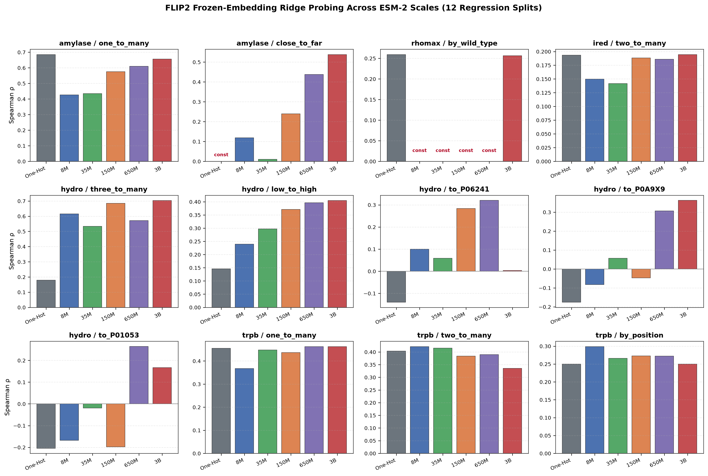
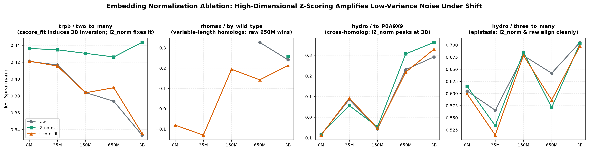
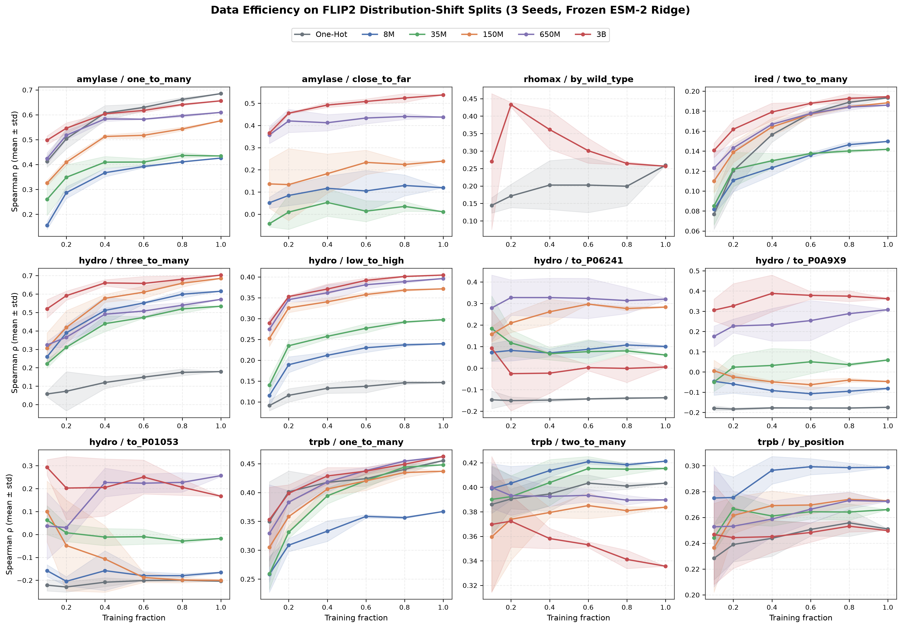
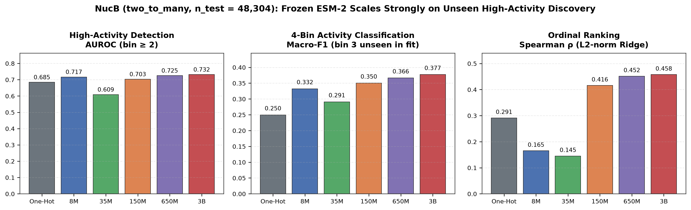
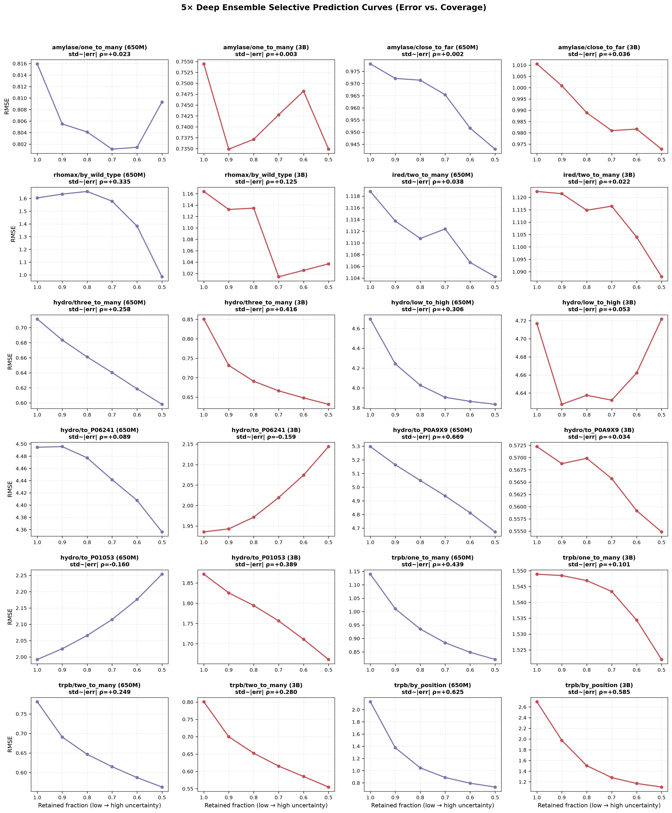
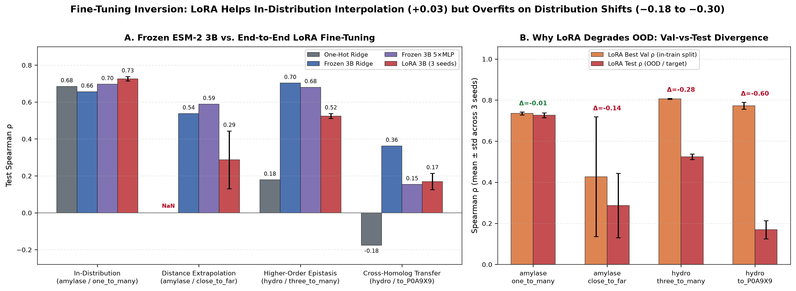

# Scaling, Data Efficiency, Uncertainty, and Fine-Tuning Inversion of ESM-2 Representations on FLIP2 Distribution-Shift Benchmarks

**Technical Report (v1.0 — November 2026)**
**Code & Reproducible Notebooks:** `notebook_01` – `notebook_04` (Colab CPU / L4 / G4 tiered pipeline)

---

## Abstract

Protein engineering tasks are defined by severe distribution shifts—extrapolating from local mutant neighborhoods to distant combinatorial variants, higher-order epistasis, unseen mutated positions, or distinct homologous scaffolds. Using **FLIP2** (Didi et al., ICML 2026), we conduct a controlled, protocol-faithful evaluation of **frozen ESM-2 representations across five parameter scales (8M, 35M, 150M, 650M, 3B)** against sparse one-hot baselines and **end-to-end ESM-2 3B LoRA fine-tuning** across **6 datasets and 13 official splits** (317,976 unique sequences; 12 regression splits + 1 ordinal 4-bin classification split `nucb`).

Our experiments establish four empirical findings with immediate practical consequences for protein ML systems:
1. **Extrapolation vs. Interpolation Bifurcation:** Under combinatorial distance (`amylase/close_to_far`), higher-order epistasis (`hydro/three_to_many`), and cross-homolog transfer (`hydro/to_P06241`, `to_P0A9X9`, `to_P01053`), one-hot Ridge either collapses to a constant (`NaN`) or yields negative correlation ($\rho \in [-0.204, -0.140]$), whereas frozen ESM-2 650M/3B embeddings scale monotonically up to $\rho = 0.538\text{–}0.703$ (and $+0.321\text{–}+0.362$ cross-homolog) and match $10\times$ smaller models with only $10\%$ of training labels. Conversely, on dense local single-wild-type scans (`amylase/one_to_many`), sparse one-hot remains competitive with frozen linear probing ($\rho = 0.685$ vs. $0.656$).
2. **Feature Normalization Controls High-Dimensional Scaling Inversion:** Per-feature z-scoring (`zscore_fit`) on 2,560-dimensional 3B embeddings induces a spurious **inverse scaling law** on `trpb/two_to_many` ($8\text{M}=0.421 > 3\text{B}=0.336$) by amplifying near-zero-variance training dimensions; switching to row-wise **$\ell_2$ normalization** restores monotonic superiority ($3\text{B}=0.443$, test MSE $1.310 \to 0.888$).
3. **5× Deep Ensemble Selective Prediction & Its Epistemic Blind Spot:** Predictive standard deviation reliably prioritizes low-error variants on combinatorial and positional shifts—cutting test RMSE by **$-59.1\%$ to $-65.6\%$** at $50\%$ coverage on `trpb/by_position` ($\text{std}\sim|err|\ \rho = 0.585\text{–}0.625$) and **$-25.8\%$** on `hydro/three_to_many` ($\rho = 0.416$)—but exhibits negative error correlation ($\rho \approx -0.16$) under severe cross-homolog global offset (`hydro/to_P06241` 3B, `hydro/to_P01053` 650M).
4. **Fine-Tuning Inversion Under Distribution Shift:** End-to-end LoRA fine-tuning of ESM-2 3B (3 seeds) improves in-distribution interpolation (`amylase/one_to_many`: $0.697 \to \mathbf{0.726} \pm 0.012$) **but degrades every tested distribution-shifted split by $-0.18$ to $-0.30$ Spearman** relative to frozen 3B probing (`close_to_far`: $0.589 \to 0.287$; `three_to_many`: $0.703 \to 0.524$; `to_P0A9X9`: $0.362 \to 0.169$). Because FLIP2 validation sets are drawn from the training domain, `val_mse` early stopping rewards local fitting ($\text{val}\ \rho = 0.61\text{–}0.81$) while distorting the pretrained evolutionary manifold needed out-of-distribution.

---

## 1. Introduction

Pretrained protein language models (pLMs) such as ESM-2 (Lin et al., 2023) are routinely deployed in two ways for variant effect and fitness prediction: (i) **frozen residue-mean embeddings** paired with lightweight Ridge or MLP heads, and (ii) **parameter-efficient fine-tuning (LoRA)** (Hu et al., 2022). While frozen probing is orders of magnitude cheaper, practitioners often assume end-to-end LoRA is strictly stronger—and that standard feature z-scoring is harmless.

Using the newly released **FLIP2** benchmark (Didi et al., ICML 2026), whose splits explicitly isolate real protein-engineering generalization regimes, we test four concrete hypotheses across the full ESM-2 family (`8M`, `35M`, `150M`, `650M`, `3B`):
- **H1 (Scaling & Data Efficiency):** Do larger frozen pLMs deliver disproportionate gains specifically on extrapolation splits, and how many labeled variants can they save?
- **H2 (Normalization Sensitivity):** Does feature preprocessing (`raw` vs. `l2_norm` vs. `zscore_fit`) alter model ranking across fixed-length single-WT scans versus variable-length multi-homolog datasets?
- **H3 (Uncertainty Quantification):** Can a lightweight 5× MLP Deep Ensemble over frozen embeddings support reliable selective prediction (`error–coverage`), and where does epistemic UQ fail?
- **H4 (Frozen vs. LoRA):** When validation is sampled from the training distribution (standard FLIP2 protocol), does 3B LoRA outperform or underperform frozen 3B probing across in-distribution vs. OOD regimes?

---

## 2. Benchmark Protocol & Dataset Audit

We strictly follow the official `J-SNACKKB/FLIP` specification verified directly against the downloaded `.csv.gz` archives (`flip.protein.properties`, SHA-256 checksums recorded in `benchmark_manifest.json`):

- **Partitions:** `fit = (set == "train") & (~validation)`, `val = (set == "train") & validation` (used strictly for hyperparameter selection / early stopping), and `test = (set == "test")` (evaluated once).
- **Target Standardization:** For regression tasks, `StandardScaler` is fit on all `set == "train"` rows (`fit | val`). Official NDCG is computed via `sklearn.metrics.ndcg_score((y_test - y_test.min())[None, :], pred[None, :])`.
- **Near-Constant Collapse Flag:** Predictions with `std(pred) < 1e-4` are flagged `pred_constant = True` and reported as `NaN` for Spearman $\rho$ rather than allowing floating-point iterative solver residuals to produce spurious rank correlations.

| Dataset | Splits Evaluated | Unique Seqs | Length (aa) | Task & Primary Scaling | Audit Notes |
|---|---|---:|---:|---|---|
| **Amylase** | `one_to_many` (2,574 / 644 / 488), `close_to_far` (1,426 / 356 / 1,924) | 3,706 | 425 | Regression (`zscore_fit`) | Fixed-length single-WT local vs. distance shift |
| **Rhomax** | `by_wild_type` (584 / 116 / 184) | 878 | 227–365 | Regression (`l2_norm`*) | 884 rows / 878 unique; multi-WT variable length |
| **IRED** | `two_to_many` (3,746 / 662 / 4,178) | 8,586 | 290 | Regression (`zscore_fit`) | Column order differs from W1 CSVs; parsed by name |
| **Hydro** | `three_to_many`, `low_to_high`, `to_P06241`, `to_P0A9X9`, `to_P01053` | 24,935 | 57–65 | Regression (`l2_norm`) | Variable-length multi-homolog & cross-scaffold splits |
| **NucB** | `two_to_many` (2,088 / 5,367 / 48,304) | 55,759 | 142 | 4-bin Ordinal Cls | **`bin=3` absent from `fit`** (only in `val`/`test`) |
| **TrpB** | `one_to_many` (304 / 76 / 227,918), `two_to_many`, `by_position` | 228,298 | 389 | Regression (`zscore_fit`) | Full 228k extraction for all 5 ESM-2 scales; sparse CSR one-hot |

*\*All 3 scalings (`raw`, `l2_norm`, `zscore_fit`) are systematically evaluated for every split in `ridge_probing_ablation.csv`.*

---

## 3. Experimental Setup & Systems Design

1. **Frozen PLM Embeddings (`notebook_02`):** Mean pooling over residue tokens strictly excluding BOS, EOS, and PAD tokens, extracted in `bfloat16` with native PyTorch SDPA and longest-first dynamic token-budget batching. All 317,976 unique sequences (including all 228,298 `trpb` sequences up to `esm2_3b`) were extracted without subsampling.
2. **Exact & Scalable Probing (`notebook_03`):**
   - **One-Hot Baseline:** Sparse CSR encoding (`20 × max_len`) with `scipy.sparse.linalg.lsqr` on `trpb` (>150M entries) and exact dense solver elsewhere.
   - **Exact Ridge Grid Search:** Single primal ($N > D$) or dual ($D \ge N$) `np.linalg.eigh` eigendecomposition per `(dataset, split, model, scaling)` solving all 21 regularization values $\alpha \in [10^{-4}, 10^6]$ simultaneously via `val_mse`, with zero-copy z-score weight folding for 3-seed × 6-fraction data efficiency curves.
   - **5× Deep Ensemble UQ:** Five 2-layer MLPs (`H → 256 → ReLU → Dropout(0.2) → 1`) trained with independent seeds `[0..4]` and `val_mse` early stopping on `esm2_650m` and `esm2_3b`. Selective prediction evaluates test RMSE at retained coverage fractions $\{1.0, 0.9, 0.8, 0.7, 0.6, 0.5\}$ sorted by ascending ensemble `std`.
3. **ESM-2 3B LoRA Comparison (`notebook_04`):** Native PyTorch LoRA ($r=8, \alpha=16, \text{dropout}=0.05$) injected into all `query`, `key`, `value` projections across all 36 layers of `esm2_3b` (~0.15% trainable backbone parameters) paired with an identical 2-layer MLP head (`2560 → 256 → 1`). Trained in `bfloat16` with `AdamW` ($\text{lr}_{\text{LoRA}}=2\times 10^{-4}, \text{lr}_{\text{head}}=10^{-3}$, 5% warmup + cosine decay), capped at 32 sequences/step, across 3 random seeds `[42, 43, 44]` with `val_mse` checkpoint selection.

---

## 4. Results & Analysis

### 4.1 Frozen-Embedding Scaling Across All 12 Regression Splits

| Dataset / Split | One-Hot $\rho$ | ESM-2 8M | ESM-2 35M | ESM-2 150M | ESM-2 650M | ESM-2 3B (Primary) | Best Any-Scaling (Model / Scaling / $\rho$) |
|---|---:|---:|---:|---:|---:|---:|---|
| `amylase / one_to_many` | **0.6850** | 0.4260 | 0.4345 | 0.5759 | 0.6095 | 0.6561 | `one_hot` / `l2_norm` / **0.6905** |
| `amylase / close_to_far` | `const` | 0.1191 | 0.0107 | 0.2393 | 0.4377 | **0.5377** | `esm2_3b` / `zscore_fit` / **0.5377** |
| `rhomax / by_wild_type` | **0.2591** | `const` | `const` | `const` | `const` | 0.2566 | `esm2_650m` / `raw` / **0.3269** |
| `ired / two_to_many` | 0.1933 | 0.1496 | 0.1417 | 0.1883 | 0.1860 | **0.1944** | `esm2_3b` / `l2_norm` / **0.1957** |
| `hydro / three_to_many` | 0.1788 | 0.6151 | 0.5337 | 0.6848 | 0.5711 | **0.7029** | `esm2_3b` / `raw` / **0.7052** |
| `hydro / low_to_high` | 0.1463 | 0.2396 | 0.2972 | 0.3713 | 0.3960 | **0.4044** | `esm2_3b` / `l2_norm` / **0.4044** |
| `hydro / to_P06241` | -0.1402 | 0.0998 | 0.0591 | 0.2841 | **0.3205** | 0.0036 | `esm2_650m` / `l2_norm` / **0.3205** |
| `hydro / to_P0A9X9` | -0.1758 | -0.0823 | 0.0563 | -0.0470 | 0.3067 | **0.3623** | `esm2_3b` / `l2_norm` / **0.3623** |
| `hydro / to_P01053` | -0.2042 | -0.1677 | -0.0194 | -0.1981 | **0.2647** | 0.1666 | `esm2_650m` / `raw` / **0.2736** |
| `trpb / one_to_many` | 0.4553 | 0.3671 | 0.4480 | 0.4368 | 0.4622 | **0.4624** | `esm2_3b` / `zscore_fit` / **0.4624** |
| `trpb / two_to_many` | 0.4033 | **0.4213** | 0.4153 | 0.3837 | 0.3897 | 0.3356 | `esm2_3b` / `l2_norm` / **0.4434** |
| `trpb / by_position` | 0.2500 | **0.2988** | 0.2660 | 0.2728 | 0.2724 | 0.2498 | `esm2_8m` / `zscore_fit` / **0.2988** |

**Key takeaway:** Representation advantage tracks **domain shift severity**. When sequence positions align cleanly around a single scaffold (`amylase/one_to_many`, `trpb/one_to_many` with $n_{\text{fit}}=304$), one-hot residue indicators remain surprisingly strong. Once test variants move far in edit distance (`close_to_far`, `three_to_many`) or across unaligned homologs (`hydro/to_P0*`), one-hot fails completely (`NaN` or negative $\rho$) while 650M/3B unlock $+0.32$ to $+0.70$ Spearman.

---

### 4.2 Normalization Ablation: Explaining & Fixing the 3B Scaling Inversion

A major methodological finding from our 3-way ablation (`ridge_probing_ablation.csv`) is that **per-feature z-scoring (`zscore_fit`) can invert PLM scaling laws under narrow training distributions**:
- On `trpb/two_to_many` ($n_{\text{fit}}=8{,}633$ 1- and 2-mutants tested on 217,507 higher-order variants), default `zscore_fit` produces a textbook negative scaling trend: `8M (0.4213) > 35M (0.4153) > 150M (0.3837) > 650M (0.3897) > 3B (0.3356)`, and `5×MLP` with `zscore_fit` drops 3B even further to `0.3099`.
- Replacing `zscore_fit` with **`l2_norm`** immediately restores monotonic scaling and makes **3B the top model at $\rho = 0.4434$** (reducing test MSE from `1.310` to `0.888`).
- **Mechanism:** In a 2,560-dimensional space fit on shallow mutational neighborhoods, hundreds of pretrained dimensions vary minimally across `fit`. Dividing by tiny training standard deviations inflates out-of-distribution perturbations into dominant variance; $\ell_2$ normalization preserves cosine geometry without amplifying stale dimensions. A related sensitivity occurs in variable-length `rhomax/by_wild_type` ($n_{\text{fit}}=584$), where `raw` 650M reaches $\rho=0.3269$ while `l2_norm` is over-regularized to $\alpha=10^6$ by `val_mse`.

---

### 4.3 Data Efficiency Curves

Across 3 random seeds and training fractions $\{0.1, 0.2, 0.4, 0.6, 0.8, 1.0\}$:
- **`amylase / close_to_far`:** Frozen `esm2_3b` with **10% labels** ($n=142$, $\rho = 0.3657 \pm 0.021$) outperforms `esm2_150m` with **100% labels** ($\rho = 0.2393$) by $+0.126$ Spearman.
- **`hydro / three_to_many`:** `esm2_3b` at **10% labels** ($n=116$, $\rho = 0.5197 \pm 0.050$) nearly matches `esm2_35m` at **100% labels** ($0.5336$) and triples `one_hot` at 100% ($0.1788$).
- **`hydro / to_P0A9X9`:** `esm2_3b` reaches $\rho = 0.3055 \pm 0.054$ at 10% labels, matching `esm2_650m` at 100% ($0.3077$).

---

### 4.4 High-Activity Discovery on NucB (Unseen Optimal Bin)

In `nucb/two_to_many` ($n_{\text{fit}}=2{,}088$, $n_{\text{test}}=48{,}304$), labels are 4 ordinal activity bins $\{0, 1, 2, 3\}$, and **`bin=3` is completely absent from `fit`** (appearing only in `val` and `test`). Frozen ESM-2 embeddings yield substantial gains across every metric:

| Model (Best Scaling per Task) | 4-Bin Accuracy | 4-Bin Macro-F1 | High-Activity (`bin ≥ 2`) AUROC | High-Activity AUPRC | Ordinal Spearman (L2) | Ordinal NDCG (L2) |
|---|---:|---:|---:|---:|---:|---:|
| `one_hot` (`raw` / `l2`) | 0.3444 (0.4217 `l2`) | 0.2496 | 0.6845 | 0.2673 | 0.2909 | 0.8951 |
| `esm2_8m` (`zscore_fit`) | 0.4949 | 0.3323 | 0.7169 | 0.3261 | 0.1652 | 0.8789 |
| `esm2_35m` (`zscore_fit`) | 0.4794 | 0.2909 | 0.6089 | 0.2645 | 0.1452 | 0.8783 |
| `esm2_150m` (`zscore_fit`) | 0.5265 | 0.3502 | 0.7030 | 0.2924 | 0.4159 | 0.9085 |
| `esm2_650m` (`zscore_fit` / `raw`) | 0.5610 (0.6014 `l2`) | 0.3665 | 0.7252 | **0.3685** (`raw`) | 0.4516 | **0.9166** |
| `esm2_3b` (`zscore_fit` / `l2`) | 0.5531 (**0.6032** `l2`) | **0.3772** (+51%) | **0.7315** | 0.3168 | **0.4576** (+57%) | 0.9136 |

---

### 4.5 5× Deep Ensemble Uncertainty Quantification & Epistemic Failure Modes

Across 24 `(split, model)` pairs (`650M`, `3B`), rejecting the 50% highest-uncertainty predictions lowers test RMSE in **21 of 24 cases**, with the strongest risk-control on combinatorial and positional shifts:
- **`trpb / by_position`:** RMSE drops **$-65.6\%$** for `650M` (`2.129 → 0.732`, $\text{std}\sim|err|\ \rho = +0.625$, Pearson $+0.768$) and **$-59.1\%$** for `3B` (`2.697 → 1.103`, $\rho = +0.585$).
- **`trpb / two_to_many`:** RMSE drops **$-27.9\%$** (`650M`) and **$-30.7\%$** (`3B`), with `NDCG@10%` reaching `0.939–0.944`.
- **`hydro / three_to_many`:** RMSE drops **$-15.9\%$** (`650M`, $\rho=+0.258$) and **$-25.8\%$** (`3B`, $\rho=+0.416$).
- **Documented Failure Mode (Global Scaffold Offset):** On `hydro/to_P06241 (3B)` and `hydro/to_P01053 (650M)`, $\text{std}\sim|err|\ \rho \approx -0.16$ and selective filtering slightly increases RMSE ($+10.8\%$ and $+13.1\%$). When an entire held-out homolog exhibits a systematic mean activity shift outside the training support, ensemble members can agree closely (low variance) while being uniformly biased.

---

### 4.6 Fine-Tuning Inversion: ESM-2 3B LoRA vs. Frozen Probing

| Dataset / Split | Regime | One-Hot $\rho$ | Frozen 3B Ridge $\rho$ | Frozen 3B 5×MLP $\rho$ | LoRA 3B Val $\rho$ | **LoRA 3B Test $\rho$ (3 seeds)** | LoRA Test MSE | $\Delta$ vs. Best Frozen 3B |
|---|---|---:|---:|---:|---:|---|---:|---:|
| `amylase / one_to_many` | In-distribution | 0.6850 | 0.6561 | 0.6967 | 0.7351 | **0.7261 ± 0.0121** | **0.536 ± 0.049** | **+0.0294** |
| `amylase / close_to_far` | Distance extrap. | `const` | 0.5377 | **0.5888** | 0.4271 | 0.2870 ± 0.1564 | 1.593 ± 0.292 | **−0.3018** |
| `hydro / three_to_many` | Epistasis extrap. | 0.1788 | **0.7029** | 0.6802 | 0.8059 | 0.5244 ± 0.0135 | **0.500 ± 0.010** | **−0.1785** |
| `hydro / to_P0A9X9` | Cross-homolog | -0.1758 | **0.3623** | 0.1537 | 0.7727 | 0.1693 ± 0.0444 | 0.509 ± 0.378 | **−0.1930** |

**Analysis of the Inversion:**
1. **Why LoRA wins in-distribution (`one_to_many`):** `val` and `test` share the same mutational neighborhood; adapting Q/K/V projections lets 3B specialize residue interactions (`val ρ = 0.735` transfers cleanly to `test ρ = 0.726`), outperforming frozen 3B 5×MLP and one-hot while cutting test MSE (`0.536`).
2. **Why LoRA fails OOD (`close_to_far`, `three_to_many`, `to_P0A9X9`):** Under FLIP2's protocol, `val` is sampled from `train`. On `hydro/three_to_many` and `to_P0A9X9`, LoRA drives `val_spearman` up to `0.806` and `0.773` (`val_mse` `0.14–0.21`), **yet test Spearman drops by $-0.28$ and $-0.60$ relative to validation**! Fine-tuning reshapes attention geometry around training-domain scaffolds/distances, erasing the general evolutionary priors that frozen linear probing retains. Notably, on `three_to_many` and `to_P0A9X9`, LoRA still achieves lower test MSE (`0.50`) than Ridge (`1.05` / `303.6`) by calibrating target scale/offset, even while losing fine-grained rank ordering.

---

## 5. Practical Recommendations & Next Steps

1. **Default Baseline Policy for Protein Fitness Engineering:** Start with **L2-normalized frozen ESM-2 650M/3B Ridge** (especially under combinatorial or cross-homolog shift) before investing GPU hours in end-to-end LoRA. Reserve LoRA for in-distribution refinement—or pair it with **OOD-aware validation splits** rather than random within-train validation.
2. **Uncertainty-Guided Screening:** Use a 5× MLP ensemble over frozen embeddings to filter high-variance candidates within a scaffold family, but pair it with **input-space distance / homolog novelty checks** to guard against global scaffold offset.
3. **Planned Extension:** Apply this leakage-resistant evaluation and UQ framework to clinical variant interpretation (**ClinVar VUS** gene-held-out & temporal splits, benchmarking ESM-2 against **AlphaGenome** variant impact predictions).

---

## References

1. Didi, K. et al. (2026). *FLIP2: Evaluating Protein Language Models on Realistic Distribution Shifts*. ICML 2026. (`https://doi.org/10.64898/2026.02.23.707496`)
2. Dallago, C. et al. (2021). *FLIP: Benchmark tasks in fitness landscape inference for proteins*. NeurIPS Datasets and Benchmarks.
3. Lin, Z. et al. (2023). *Evolutionary-scale prediction of atomic-level protein structure with a language model*. Science, 379(6637).
4. Hu, E. J. et al. (2022). *LoRA: Low-Rank Adaptation of Large Language Models*. ICLR 2022.
5. Lakshminarayanan, B., Pritzel, A., & Blundell, C. (2017). *Simple and Scalable Predictive Uncertainty Estimation using Deep Ensembles*. NeurIPS 2017.
